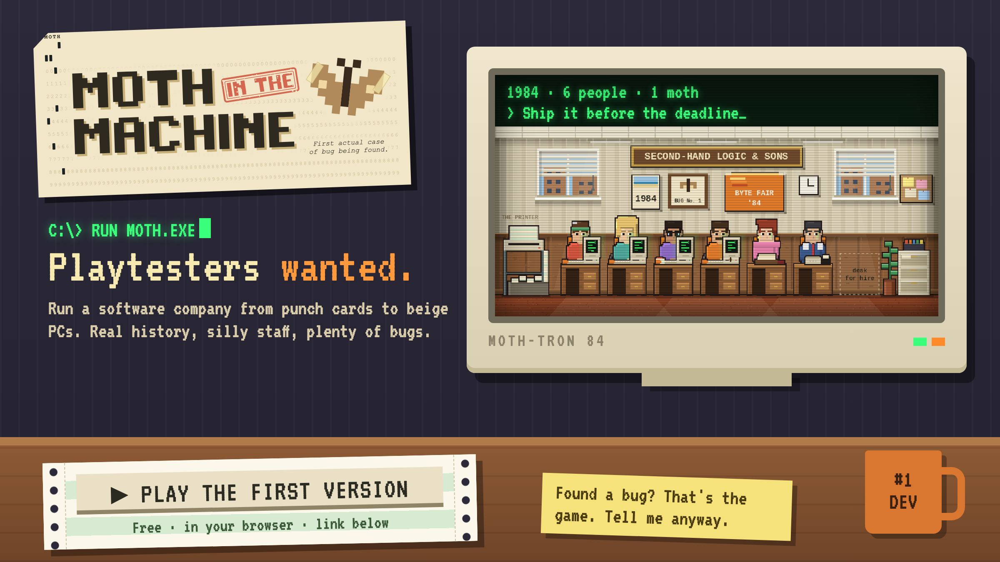

# Moth in the Machine: playtest

A small tycoon game about running a software company, from punch cards to beige PCs. Real history, silly staff, plenty of bugs. Some of them on purpose.

**▶ [Play it in your browser](https://estruyf.github.io/moth-in-the-machine-playtest/)**

Free, nothing to install. Your games are saved in your browser.

## What I'd love to hear

Play as long as it's fun, then tell me:

- When did you stop, and why?
- What made you laugh?
- Where were you confused or stuck?
- Did anything feel unfair?

**[Leave your feedback](../../issues/new?template=playtest.yml)** · **[Report a bug](../../issues/new?template=bug.yml)** · **[Just chat](../../discussions)**

English or Dutch, both fine.

## Send your runs (it helps a lot)

The game keeps a log of every run, and I can replay it click by click. That shows me exactly where things went wrong, or where you got bored.

1. Go back to the title screen.
2. Click **Your runs**.
3. Click **Download all runs**. You get a `.json` file. Games you haven't finished are in it too.
4. Drag that file into your feedback issue.

If GitHub won't take the `.json`, zip it first.

## What's in this version

- **The mainframe era (1955 onward):** punch cards, operators and a moth in the relay.
- **The PC era (1980s):** a garage, beige boxes, floppies and your own programs in the shops.

The later eras (internet, cloud, AI) aren't built yet.

---

The source lives in a private repo for now. This one only holds the playable build and your feedback.
